<div align="center">



<a href="https://x.com/SoraiaDev"></a>
<a href="https://www.linkedin.com/in/soraia-fern%C3%A1ndez-579b711b3/"></a>
<a href="mailto:sorilc@hotmail.com"></a>

</div>

## hey, i'm soraia 👋

i'm a software engineer turned solo founder, building from a small village in galicia, spain.

i studied software engineering, spent my early days deep in c and c++ (malloc, virtual machines, ftp servers, the fun stuff), then fell in love with the frontend and spent a couple of years building products for other companies. in december 2024 i got tired of digging through devtools to grab a font or an svg, so i built a tool to do it for me. that side project became my job.

today i design, code, market and support everything myself. no co-founder, no funding, no team. just shipping and learning in public.



## the road so far



## what i've built

- **[miromiro](https://miromiro.app)** · my first product. it looks at any website and gives you its design back as real code and assets. now an extension, an API, an MCP server, a ChatGPT app and an n8n node. 20K+ installs, $55K+ in gross sales, Chrome Web Store featured.
- **[pocketui](https://pocketui.app)** · *coming soon.* a library of real UI you collect yourself, ready for your AI agents.
- **[HISI](https://github.com/Diabolocom-Research/HISI-interface)** · real-time speech recognition evaluation tool, where i was lead frontend dev.

## things i believe

```txt
> distribution beats features. a great product nobody finds is a hobby.
> write for your ideal customer, not for traffic.
> the software of the future is agent ready, not click-by-click.
```

## how i spend my days

```txt
building    vue · nuxt · typescript · tailwind · node · supabase
hosting     hetzner · coolify · aws ses · listmonk   (i like owning my stack)
studying    master's in interaction design & ux @ UOC   (purely for the love of design)
writing     building in public on X, essays on medium
off-screen  photography, good food, travel, pokémon fangames
```

<details>
<summary><b>the c/c++ era</b> &nbsp;(where i learned how computers actually work)</summary>
<br/>

- [**redis_server**](https://github.com/SoraiaBarroso/redis_server) · Redis-like client and server in C++
- [**my_ftp**](https://github.com/SoraiaBarroso/my_ftp) · multithreaded FTP server in C++
- [**my_abstract_vm**](https://github.com/SoraiaBarroso/my_abstract_vm) · stack-based virtual machine in C++
- [**my_malloc**](https://github.com/SoraiaBarroso/my_malloc) · dynamic memory allocation from scratch in C
- [**my_mouse**](https://github.com/SoraiaBarroso/my_mouse_project) · A* pathfinding through a labyrinth
- [**my_sqlite**](https://github.com/SoraiaBarroso/my_sqlite) · a tiny SQLite in Ruby
- [**twitter_clone_nuxt**](https://github.com/SoraiaBarroso/twitter_clone_nuxt) · full stack Nuxt 3, Tailwind, MongoDB, Prisma

</details>

<br/>



<div align="center">
<sub>made in galicia · always shipping something</sub>
</div>
